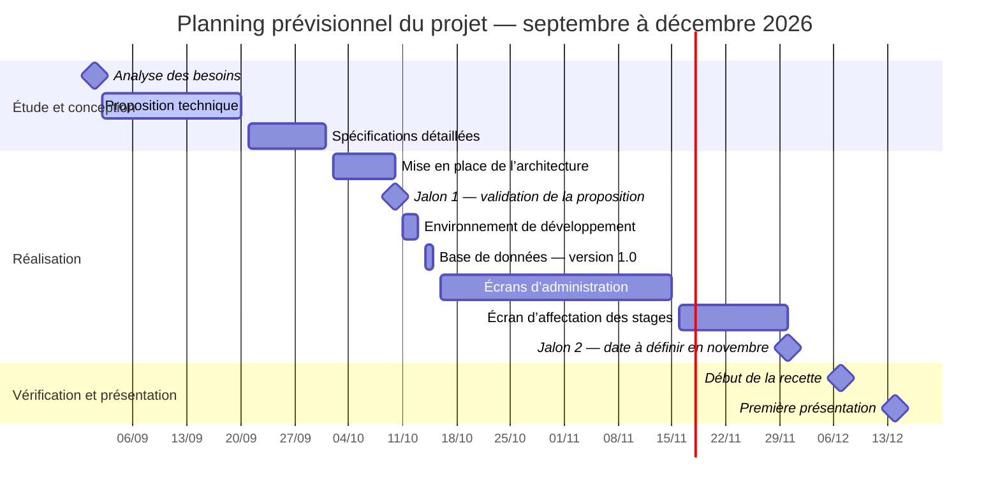

# Planning prévisionnel du projet

> Ce document présente les principales activités et échéances du projet. Les dates correspondent aux éléments communiqués. En l’absence de dates de début précises pour certaines tâches, les périodes représentées dans le diagramme de Gantt constituent une estimation prévisionnelle et devront être ajustées avec l’encadrant.

## 1. Étude et conception

| Activité | Échéance prévisionnelle |
|---|---:|
| Analyse des besoins | 1 septembre 2026 |
| Élaboration de la proposition technique | 20 septembre 2026 |
| Rédaction des spécifications détaillées | 1 octobre 2026 |

## 2. Développements et réalisation

| Activité | Échéance prévisionnelle |
|---|---:|
| Mise en place de l’architecture | 10 octobre 2026 |
| Mise en place de l’environnement de développement | 13 octobre 2026 |
| Création de la base de données — version 1.0 | 15 octobre 2026 |
| Développement des écrans d’administration | 15 novembre 2026 |
| Développement de l’écran d’affectation des stages | 30 novembre 2026 |
| Autres développements | À préciser selon le périmètre fonctionnel retenu |

## 3. Jalons de suivi

| Jalon | Date prévisionnelle | Résultat attendu |
|---|---:|---|
| **Jalon 1** | 10 octobre 2026 | Validation de la proposition technique par l’encadrant |
| **Jalon 2** | À définir en novembre 2026 | Présentation de l’état d’avancement et validation des orientations avec l’encadrant |
| **Jalon 3** | 7 décembre 2026 | Début de la phase de recette |
| **Jalon 4** | 14 décembre 2026 | Première présentation du projet |

## 4. Diagramme de Gantt prévisionnel

Les périodes de réalisation ci-dessous sont indicatives : elles ont été estimées à partir des échéances communiquées, faute de dates de début détaillées. Les jalons sont représentés par des points de contrôle. La date du deuxième jalon reste à fixer.

> **Remarque :** le Jalon 2 est placé provisoirement au 30 novembre dans le diagramme afin de permettre sa visualisation. Cette date n’est pas validée et doit être confirmée avec l’encadrant. Les durées estimées devront également être révisées en fonction de l’avancement effectif.

## 5. Éléments à confirmer

- Fixer la date du Jalon 2 avec l’encadrant.
- Compléter la liste des développements restant à réaliser et préciser leurs échéances.
- Confirmer les dates et le contenu de la recette ainsi que les modalités de la première présentation.
- Réviser les périodes estimées du diagramme au fur et à mesure de l’avancement du projet.
